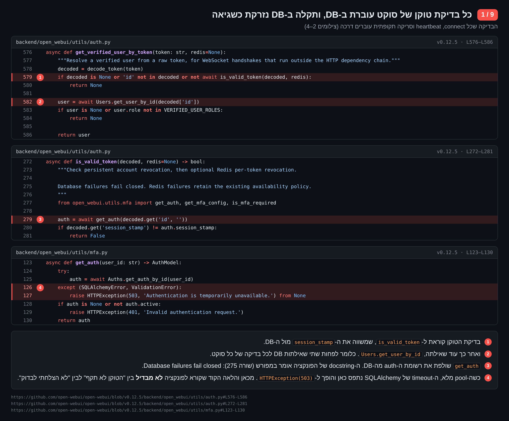
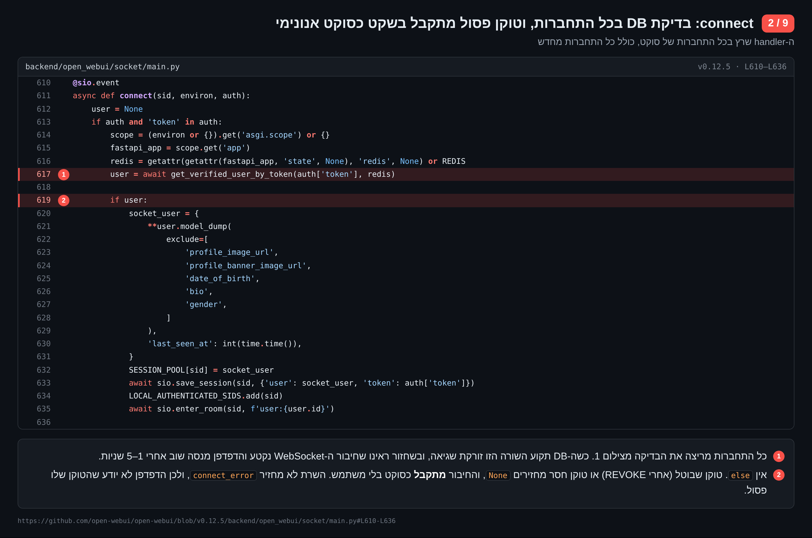
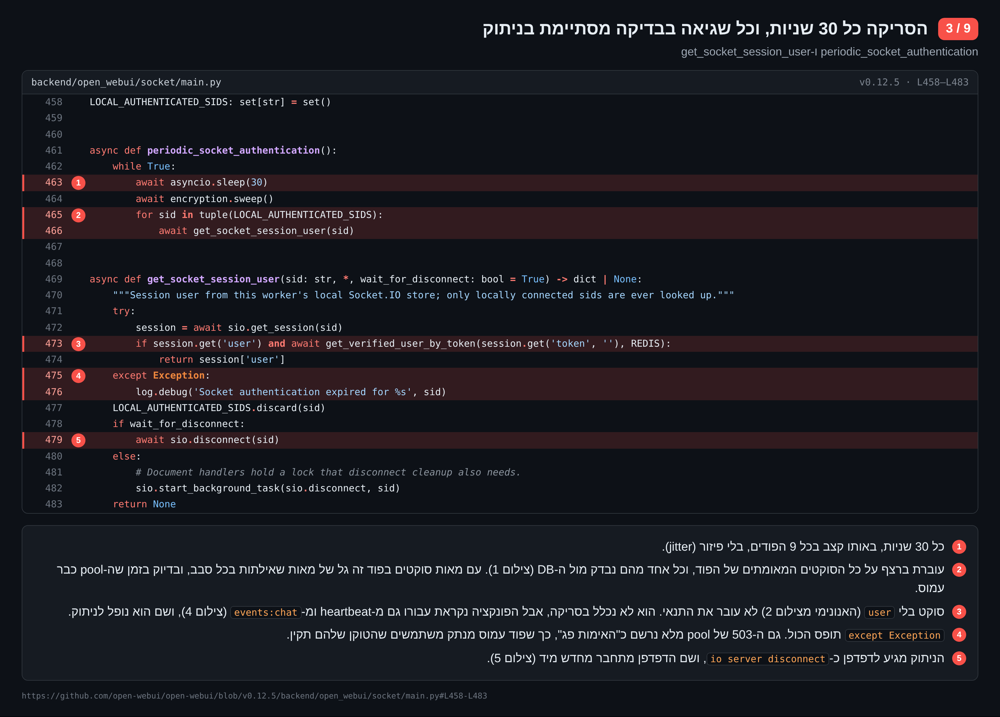
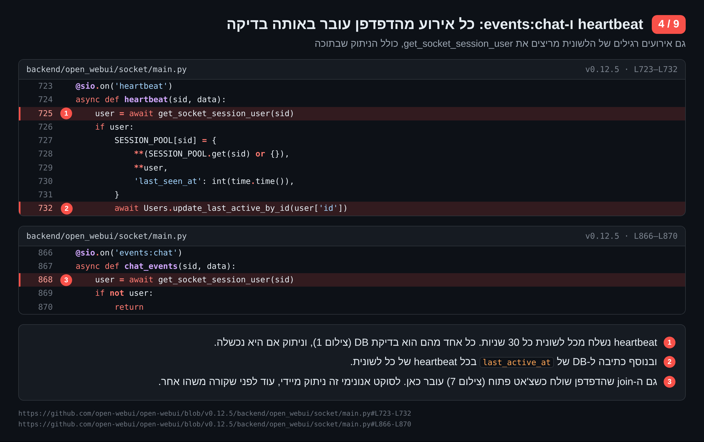
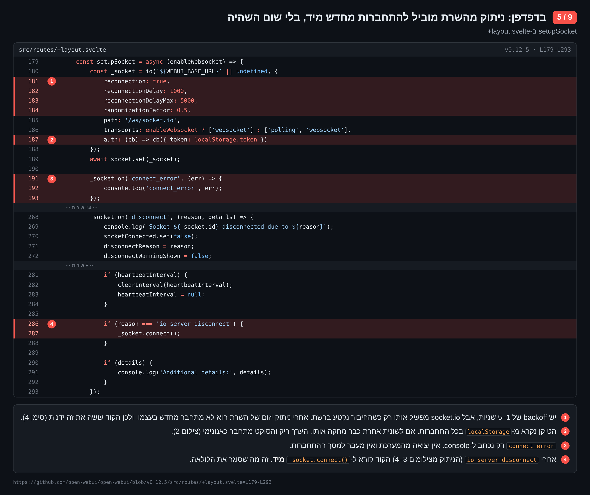
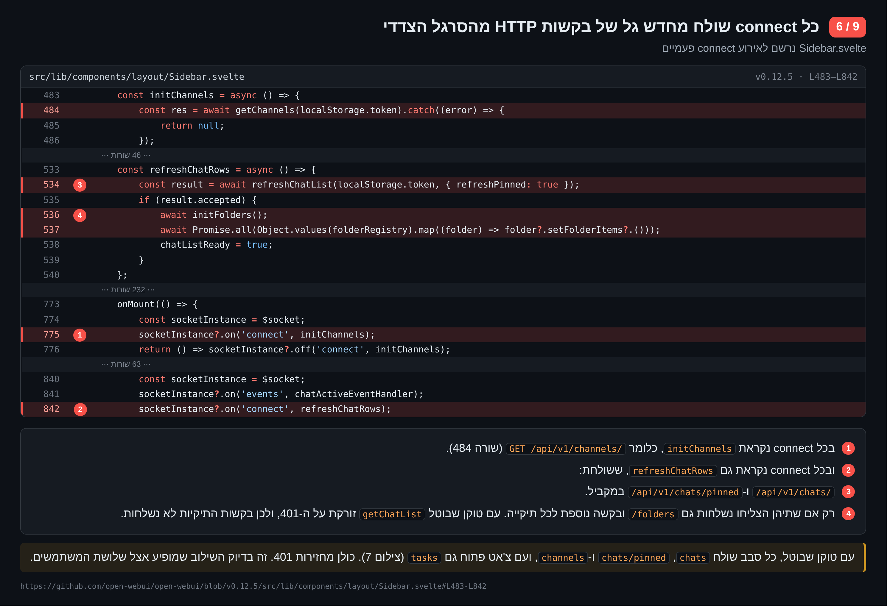
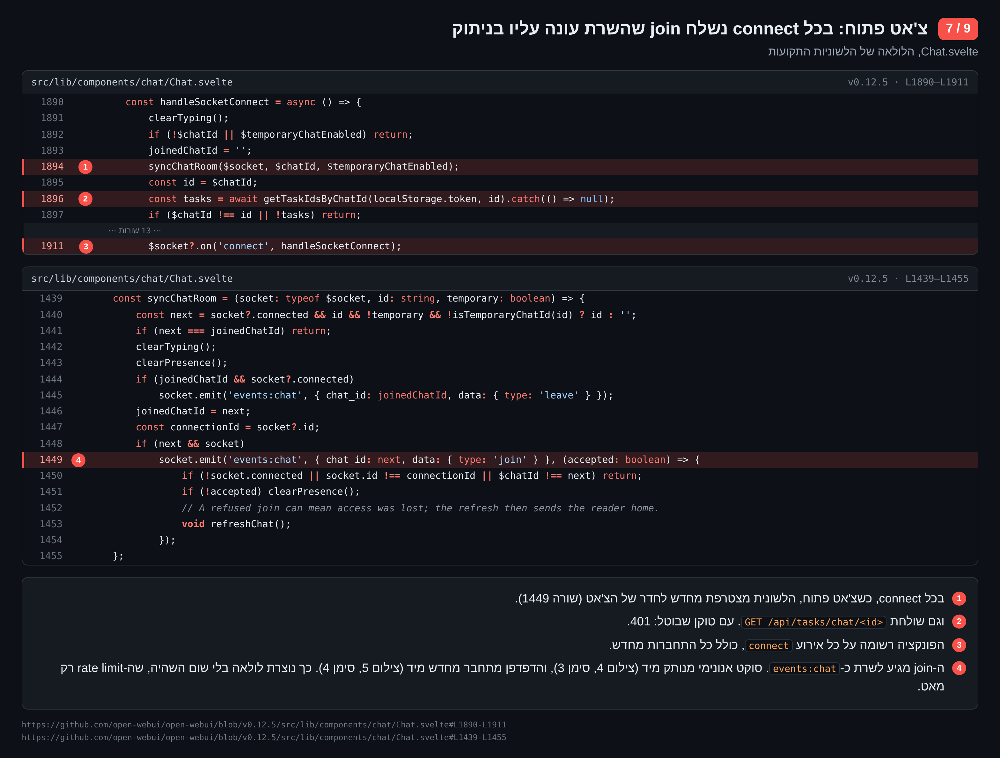
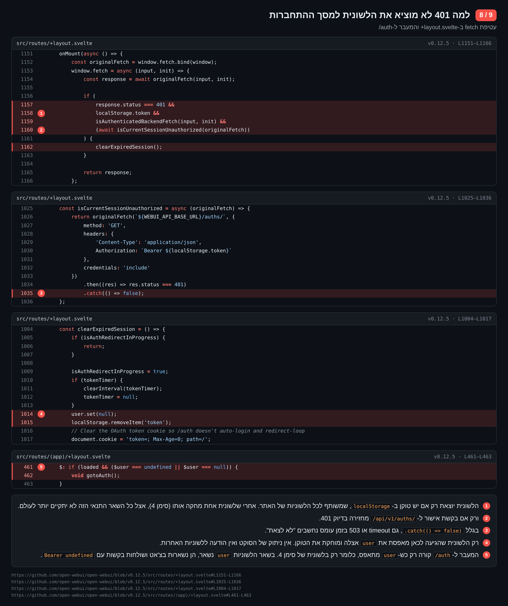
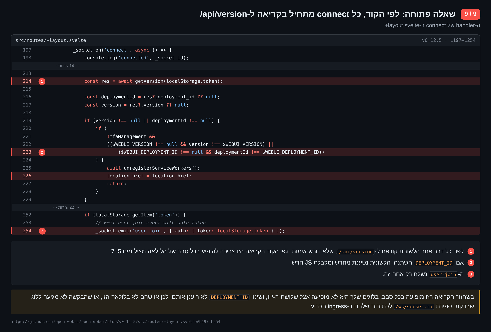

# Code snapshots (v0.12.5)

Annotated screenshots of the unmodified v0.12.5 source. Line numbers are the real ones; every rendered line is checked
against the source file. Notes inside the images are in Hebrew. Regenerate with `tools/snapshots/make.py`.

## 1. Every socket token check hits the DB; a DB failure raises (503)

[`auth.py#L576-L586`](https://github.com/open-webui/open-webui/blob/v0.12.5/backend/open_webui/utils/auth.py#L576-L586), [`auth.py#L272-L281`](https://github.com/open-webui/open-webui/blob/v0.12.5/backend/open_webui/utils/auth.py#L272-L281), [`mfa.py#L123-L130`](https://github.com/open-webui/open-webui/blob/v0.12.5/backend/open_webui/utils/mfa.py#L123-L130)

## 2. connect: DB check on every connect; an invalid token is silently accepted as an anonymous socket

[`main.py#L610-L636`](https://github.com/open-webui/open-webui/blob/v0.12.5/backend/open_webui/socket/main.py#L610-L636)

## 3. 30 s sweep; any error in the check ends in a disconnect

[`main.py#L458-L483`](https://github.com/open-webui/open-webui/blob/v0.12.5/backend/open_webui/socket/main.py#L458-L483)

## 4. heartbeat and events:chat run the same check (and disconnect)

[`main.py#L723-L732`](https://github.com/open-webui/open-webui/blob/v0.12.5/backend/open_webui/socket/main.py#L723-L732), [`main.py#L866-L870`](https://github.com/open-webui/open-webui/blob/v0.12.5/backend/open_webui/socket/main.py#L866-L870)

## 5. Client: io server disconnect -> _socket.connect() immediately, no delay

[`+layout.svelte#L179-L293`](https://github.com/open-webui/open-webui/blob/v0.12.5/src/routes/+layout.svelte#L179-L293)

## 6. Every connect re-fetches channels, chats, pinned (and folders)

[`Sidebar.svelte#L483-L842`](https://github.com/open-webui/open-webui/blob/v0.12.5/src/lib/components/layout/Sidebar.svelte#L483-L842)

## 7. Open chat: every connect emits a join the server answers with a disconnect

[`Chat.svelte#L1890-L1911`](https://github.com/open-webui/open-webui/blob/v0.12.5/src/lib/components/chat/Chat.svelte#L1890-L1911), [`Chat.svelte#L1439-L1455`](https://github.com/open-webui/open-webui/blob/v0.12.5/src/lib/components/chat/Chat.svelte#L1439-L1455)

## 8. Why 401 does not send sibling tabs to the login page

[`+layout.svelte#L1151-L1166`](https://github.com/open-webui/open-webui/blob/v0.12.5/src/routes/+layout.svelte#L1151-L1166), [`+layout.svelte#L1025-L1036`](https://github.com/open-webui/open-webui/blob/v0.12.5/src/routes/+layout.svelte#L1025-L1036), [`+layout.svelte#L1004-L1017`](https://github.com/open-webui/open-webui/blob/v0.12.5/src/routes/+layout.svelte#L1004-L1017), [`+layout.svelte#L461-L463`](https://github.com/open-webui/open-webui/blob/v0.12.5/src/routes/(app)/+layout.svelte#L461-L463)

## 9. Open question: every connect starts with /api/version, which production logs do not show

[`+layout.svelte#L197-L254`](https://github.com/open-webui/open-webui/blob/v0.12.5/src/routes/+layout.svelte#L197-L254)

